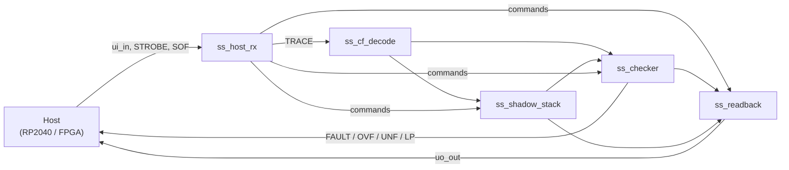

   

# Zicfiss-inspired external shadow-stack monitor

A Tiny Tapeout (Sky130, ttsky26d) tile that checks the **return-address
integrity** of a RISC-V RV32IMC CPU from the outside. A host streams the CPU's
retired-instruction trace into the tile. The tile finds calls and returns using
the RISC-V return-address-stack hints, keeps its own shadow stack in on-chip
flip-flops, and raises a sticky **FAULT** when a return doesn't land where the
matching call expects. Stack smashing and ROP-style attacks are the typical cause.

> **Zicfiss-inspired, not Zicfiss-compliant.** This is a trace-based external
> monitor. It detects attacks but doesn't prevent them.

- Datasheet / pinout / protocol: [docs/info.md](docs/info.md)
- Exact rules (decode table, overflow/underflow policies, edge cases): [docs/design.md](docs/design.md)
- Local environment: [SETUP.md](SETUP.md)

## Architecture



| File | Role |
|---|---|
| `src/tt_um_sidisnotacoder_shadowstack.v` | Top level, pin map, CONFIG register |
| `src/ss_host_rx.v` | 2-flop synchronizers, strobe edge detect, SOF resync, packet assembly |
| `src/ss_cf_decode.v` | Combinational JAL/JALR/C.JAL/C.JR/C.JALR/LPAD classifier |
| `src/ss_shadow_stack.v` | Circular buffer, depth, `lost` counter, WRAP/SATURATE, desync |
| `src/ss_checker.v` | Pending-return compare, sticky flags, counters, `last_bad_pc`, landing-pad check |
| `src/ss_readback.v` | VIEW register and `uo_out` mux |

## Verification

| What | How | Result |
|---|---|---|
| Golden model | `model/shadow_model.py` + hand-checked unit tests (`pytest model`) | 30 pass |
| RTL vs model | cocotb, outputs compared after **every** packet (`cd test && make`) | 16 tests pass |
| Directed coverage | every hint-table row (32-bit and compressed), decoys (C.MV, C.ADD, C.EBREAK, C.J, non-link JAL/JALR), PC+2/PC+4, pop-then-push, WRAP/SATURATE deep recursion, underflow IGNORE/FAULT, TRAP skip, all commands, SOF resync, lost-counter saturation, forward edge | pass |
| Random | 5,000-packet random call trees (seeded; `SEED=…`, `RANDOM_PACKETS=…`) | pass |
| Mutation check | 5 deliberate RTL bugs (decoder, stack policy, skip counter, parser) | all 5 caught |
| Spike traces | 4 bare-metal programs replayed through the RTL | see below |
| Gate level | same suite on the hardened netlist (`make GATES=yes`, 800 random packets) | 16 tests pass |

### Spike demo

`sw/demo.c` is built four ways (`make -C sw`) and run with
`spike --isa=rv32imc_zicsr -l --log-commits`. `tools/spike_to_trace.py` turns the
commit log into packets. By default it keeps only the jumps, the instruction after
each jump, and trap targets (about 9% of instructions), and it checks that this
gives the same result as the full trace.

| Trace | Program | Result |
|---|---|---|
| `clean` | nested calls, recursion deeper than the stack, function pointers, an ECALL trap | no fault (overflow set, no false positives) |
| `attack` | `process()` overflows a stack buffer and overwrites the saved `ra` with `&win` | **FAULT** at the hijacked return (lands on `win()` = `0x006a`) |
| `lp_clean` | clean, built with `-fcf-protection=branch` (Zicfilp landing pads), forward-edge check on | no fault |
| `lp_attack` | an indirect call to `win+4`, past its landing pad | **LP_FAULT** in the full (1×2) build; not built in the 1×1 tapeout |

`last_bad_pc = 0x006a` for the attack and the LP_FAULT result were verified on the
full configuration (DEPTH 8, all features). The 1×1 tapeout leaves those features out,
see below. Run `tools/spike_to_trace.py --full-hw` to model the full build.

## Area and timing

The full spec (DEPTH 8, `last_bad_pc`, forward-edge check) needs a 1×2 tile. To fit
**1×1**, this tapeout follows the spec's cut order. The cut features are still in the
RTL behind parameters (`src/tt_um_sidisnotacoder_shadowstack.v`).

| Configuration tried (1×1 unless noted) | Result |
|---|---|
| DEPTH 8, all features | placement fails (synth ≈ 13,300 µm² of 16,500 µm² core) |
| DEPTH 8, no `last_bad_pc` | placement fails |
| DEPTH 8, no `last_bad_pc`, no forward-edge | placement fails |
| DEPTH 7, no `last_bad_pc`, no forward-edge | routing doesn't converge |
| DEPTH 6, all features | routing doesn't converge |
| **DEPTH 6, no `last_bad_pc`, no forward-edge** | **taped out** |
| DEPTH 8, all features, 1×2 tile | fits, 51 % utilization |

Taped-out build (LibreLane 3.0.14, sky130A, `CLOCK_PERIOD` 20 ns):

| Metric | Value |
|---|---|
| Tile | 1×1 (167 × 108 µm) |
| Standard cells (excl. fill/tap) | 1,148, of which 208 flip-flops |
| Utilization | 74.6 % |
| Setup worst slack @ 50 MHz | +3.59 ns, so f<sub>max</sub> ≈ 61 MHz (typical corner) |
| Hold worst slack | +0.11 ns, 0 violations |
| DRC / LVS / antenna | 0 / 0 / 0 |
| Max-slew warnings | 313 (reported by the flow, not signoff errors) |

The host interface is asynchronous to the tile clock. A TRACE packet takes 6 strobed
bytes, and each byte needs ≥ 3 tile clocks high and low, so at 50 MHz the tile accepts
at most about 1.4 M packets/s.

## Hardware demo

`demo/rp2040_replay.py` (MicroPython, Tiny Tapeout demo board) replays
`clean.bin`, then CLEAR_FLAGS, then `attack.bin`, and prints `last_bad_pc`.
It has **not been tested on hardware** yet, so check the `ttboard` SDK attribute names.

## Limitations

- **Detection only.** It doesn't stop the CPU unless the FAULT pin is wired to halt or reset it.
- **False positives** with setjmp/longjmp, C++ exception unwinding, coroutines and
  context switches. Send RESET_STACK when switching contexts.
- **Traps and interrupts** need the TRAP bit from the host. Without it, an interrupt
  taken right after a return causes a false fault. With it, that one check is skipped
  (counted in view 8).
- **Only DEPTH (6) frames are checked.** Deeper frames are counted in `lost`, not verified.
  After more than 255 lost frames the monitor enters *desync* and stops checking until
  RESET_STACK.
- **Address aliasing:** only the low ADDR_W bits (16) are compared, so return targets
  64 KiB apart can't be told apart.
- **No forward-edge check or `last_bad_pc` in the 1×1 tapeout** (area). Landing-pad labels and alignment
  are never checked, even in the full build.
- Zicfiss-inspired, **not** Zicfiss/Zicfilp compliant.

## Repository layout

```
src/        RTL                      test/     cocotb testbench (tb.v, tb_host.py, test.py)
model/      Python golden model      sw/       bare-metal demo programs (Spike)
tools/      Spike log -> packets     traces/   generated packet streams + expected results
demo/       RP2040 MicroPython       docs/     datasheet + design notes
```

## About Tiny Tapeout

[Tiny Tapeout](https://tinytapeout.com) is an educational project that makes it
easier and cheaper than ever to get digital designs manufactured on a real chip.
