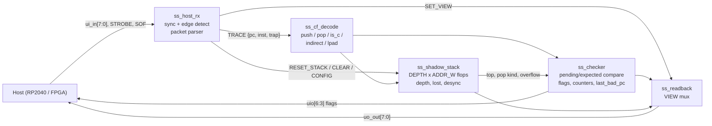

# Design notes: Zicfiss-inspired shadow-stack monitor

These are the exact rules the RTL implements. The executable version is
[`model/shadow_model.py`](../model/shadow_model.py). The cocotb tests compare the RTL
against it after every packet.

> This is an **external, trace-based** monitor that is *Zicfiss-inspired*.
> It is **not** an implementation of the RISC-V Zicfiss or Zicfilp extensions.

## Block diagram

## Parameters

| Parameter | Taped-out (1×1) | Full spec | Meaning |
|---|---|---|---|
| `DEPTH` | 6 | 8 | Shadow-stack entries (1..15) |
| `ADDR_W` | 16 | 16 | Return-address bits stored and compared (1..16) |
| `LP_EN` | 0 | 1 | Build the forward-edge (landing pad) check |
| `LBPC` | 0 | 1 | Build the `last_bad_pc` register |

The full-spec configuration needs a 1×2 tile. In a 1×1 tile it fails placement:
the design synthesizes to about 13,300 µm² of the 16,500 µm² core before hold
fixing. Following the spec's cut order, the 1×1 build drops `last_bad_pc`,
then the forward-edge check, then reduces DEPTH to 6. DEPTH 8 or 7 without the
features, and DEPTH 6 with them, were also tried and failed placement or
routing. The model's `HW_CONFIG` (in `model/shadow_model.py`) must match these
defaults.

## Classification (`ss_cf_decode`)

Link registers are x1 and x5. Only `inst[23:0]` is used.

| Instruction | Condition | Action |
|---|---|---|
| JAL | rd ∈ link | push |
| JALR (funct3=0) | rd ∉ link, rs1 ∉ link | none |
| | rd ∉ link, rs1 ∈ link | pop |
| | rd ∈ link, rs1 ∉ link | push |
| | rd ∈ link, rs1 ∈ link, rd ≠ rs1 | pop, then push |
| | rd ∈ link, rs1 ∈ link, rd = rs1 | push |
| C.JAL (q01, f3=001) | — | push |
| C.J (q01, f3=101) | — | none |
| C.JR (q10, f3=100, b12=0, rs1≠0, rs2=0) | rs1 ∈ link | pop |
| C.JALR (q10, f3=100, b12=1, rs1≠0, rs2=0) | rs1 = x5 | pop, then push |
| | otherwise | push |

C.MV (rs2≠0), C.ADD (b12=1, rs2≠0) and C.EBREAK (b12=1, rs1=0) fail the
`rs1≠0, rs2=0` test, so they are never treated as jumps. For compressed
encodings `inst[23:16]` is ignored.

* Return address = `PC + 4` (32-bit) or `PC + 2` (compressed), truncated to `ADDR_W` bits.
* **Indirect, non-return** = JALR, C.JR or C.JALR whose rs1 ∉ {x1, x5, x7}. x7 is
  exempt because Zicfilp uses it for software-guarded branches.
* **Landing pad** = `AUIPC x0, imm` (`LPAD`). The label in imm[31:12] is only partly
  sent (inst[23:12]) and is **not checked**. Neither is LPAD alignment.

## Processing one TRACE packet

Step 1 resolves the previous packet's checks, then step 2 decodes this packet.

**Step 1: previous checks**
* If `TRAP = 1`: if `pending` or `lp_pending` was set, increment `skip_count`
  (saturating). No comparison is made.
* Else: if `pending` and `PC[ADDR_W-1:0] ≠ expected`, set `fault`, increment
  `fault_count`, and set `last_bad_pc = PC`. If `lp_pending` and this
  instruction isn't an LPAD, set `lp_fault`.
* Clear `pending` and `lp_pending`.

**Step 2: this instruction**

A pop is one of three kinds, depending on the overflow policy:

| | WRAP (`cfg[0]=0`, default) | SATURATE (`cfg[0]=1`) |
|---|---|---|
| **entry** | depth > 0 | lost = 0 and depth > 0 |
| **skip** (consume one lost frame, no check) | depth = 0 and lost > 0 | lost > 0 |
| **underflow** | depth = 0 and lost = 0 | depth = 0 and lost = 0 |

* **Pop (entry):** `expected ← top`, `pending ← !desync`, depth − 1.
* **Pop (skip):** lost − 1.
* **Pop (underflow):** set `underflow`. If the underflow policy is FAULT
  (`cfg[1]=1`) and not `desync`, also set `fault` and increment `fault_count`
  (`last_bad_pc` is not updated).
* **Pop then push, with an entry:** compare-arm against the top entry, then overwrite it
  in place with the new return address. Depth is unchanged.
* **Pop then push, skip or underflow:** handle the pop as above, then do a normal push.
* **Push, stack not full:** store, depth + 1.
* **Push, stack full:** set `overflow`. If `lost = 255`, set `desync`;
  otherwise lost + 1. WRAP overwrites the oldest entry, so the innermost
  DEPTH frames are always kept. SATURATE drops the new entry, so the outermost
  DEPTH frames are kept.
* If the instruction is indirect-non-return and `lp_en` (`cfg[2]`) is set: `lp_pending ← 1`.

A single packet can raise two faults: a return mismatch from step 1 and an
underflow fault from step 2. `fault_count` then increases by 2.

### Why SATURATE skips on `lost > 0` even when depth > 0

Under SATURATE the dropped frames are the *innermost* ones, so the next
`lost` returns belong to frames that were never stored. Checking them against
the stored (outer) entries would cause false faults.

### `desync`

`lost` is an 8-bit saturating counter. If more than 255 frames are lost, the
count is no longer exact. From then on the stack can't be trusted, so `desync`
is set. While `desync` is set, return compares and underflow faults are
suppressed. RESET_STACK clears it. It isn't visible on its own pin. The
symptom is `lost = 255` in view 4.

## Commands

| Header | Command | Payload | Effect |
|---|---|---|---|
| `0x1T` | TRACE | PC[7:0], PC[15:8], INST[7:0], INST[15:8], INST[23:16] | as above. T = header bit 0 = TRAP |
| `0x20` | RESET_STACK | — | depth, lost, desync, pending, lp_pending ← 0. Flags kept |
| `0x30` | CLEAR_FLAGS | — | fault, overflow, underflow, lp_fault, fault_count, skip_count, last_bad_pc ← 0 |
| `0x40` | CONFIG | cfg | bit0 SATURATE, bit1 underflow FAULT, bit2 forward-edge enable |
| `0x50` | SET_VIEW | view | view ← payload[3:0] |

A header with any other command is ignored, along with the bytes after it up to
the next SOF. A byte with SOF=1 always starts a new packet. This discards any
partial frame.

## Readback views (`uo_out`)

| View | Value |
|---|---|
| 0 | `{depth[3:0], lp_fault, underflow, overflow, fault}` |
| 1 / 2 | `expected[7:0]` / `expected[15:8]` |
| 3 | `fault_count` |
| 4 | `lost` |
| 5 / 6 | `last_bad_pc[7:0]` / `[15:8]` |
| 7 | ID byte `0x5A` |
| 8 | `skip_count` (added: the spec has two counters but only one view slot) |
| 9–15 | 0 |

## Host timing

The tile samples STROBE and SOF through 2-flop synchronizers and takes a byte 3
clocks after STROBE rises. The host must hold DATA and SOF stable from before
STROBE rises until it falls, and keep STROBE high and low for at least 3 tile
clocks each. The tile then processes a full TRACE packet one clock after its last byte.
